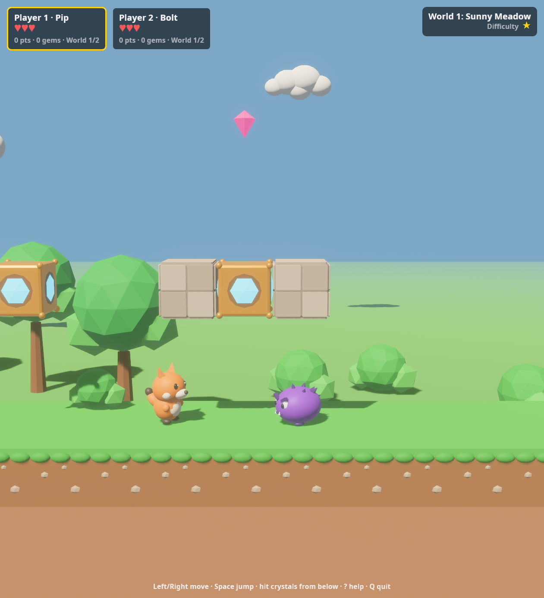

# numhop



A 3D math platformer for [Omarchy](https://omarchy.org), written in Rust with
[Bevy](https://bevyengine.org). Two siblings take turns running, jumping, and
solving math at their own level. A right answer keeps the controller; a wrong one
costs a life and passes the turn.

The game design (turn-based sibling play, age-tiered topics, a 30-second clock)
is inspired by [pgarevalo/mariomath](https://github.com/pgarevalo/mariomath).
Everything here is original: the code, the characters (Pip the fox, Bolt the
robot, and the Grumbles), and the 3D models, which are built procedurally in
Blender from `assets-src/build_models.py`. The same script rigs the characters
with a small skeleton and keys their `walk`, `idle`, and `jump` clips; the game
blends between them as they move, and speeds the walk up as they run. Heroes also
have a `death` clip: when a Grumble catches one, play stops while they tumble over,
then the turn moves on.

The sound effects are original too: there are no audio files. Each one is a few
square and triangle tones, mixed when the game starts (`src/domain/sound.rs`).
Jumps, gems, stomps, questions, right and wrong answers, checkpoints, cleared
worlds and the menu all have their own. Turn them off with **Sound** under
**Settings**; the choice is saved with the others.

## How it plays

- **One or two players.** Each starts with three lives. Solo players earn an extra
  life for every world cleared.
- **Your own name.** In the menu, pick a player's name row and press Enter to type
  it (up to 12 letters, accents and ñ included); Enter keeps it, Esc cancels. Names
  show on the banners, the HUD and the results, and are remembered for next time.
- **Crystal blocks**: jump into one from below for a question. Right: +250 points
  and 3 gems.
- **The key** before each gate asks the final question of the world. Right:
  +500 and on to the next world.
- **Lose a life** to a Grumble, a gap, a wrong answer, or the clock. In a
  two-player game the turn passes. Stomp Grumbles for +100.
- **Difficulty** grows from ★ to ★★★★ as the player progresses through the worlds.

The levels follow the Spanish primary curriculum (Primaria), from 1º to 6º.

| Level  | School year | Topics |
|--------|-------------|--------|
| Age 6  | 1º | Addition with carrying, subtraction without borrowing, in school column layout (tens in red, units in blue) |
| Age 8  | 2º–3º | Subtraction with borrowing up to three digits, times tables (2, 5 and 10 first), multiplying by one digit with carries (hundreds in green) |
| Age 10 | 4º–5º | Exact division by one digit, adding and subtracting decimals (tenths, then hundredths), a fraction of a number |
| Age 12 | 6º | Greatest common divisor, least common multiple, fractions (+ − × ÷) simplified to lowest terms |

After every answer, the game shows the worked solution.

## Shortcuts

| Key | Action |
|-----|--------|
| Left / Right, A / D | Move |
| Space, Up, W | Jump (hold for higher) |
| 1 2 3 4 | Pick an answer |
| Arrow keys + Enter | Choose an answer |
| Enter / Space | Continue |
| ? or F1 | Show all shortcuts |
| Q | Quit (asks first during a match) |

The game follows the Omarchy theme accent live, and its panels use your
Hyprland window rounding.

## Language

numhop speaks English and Spanish (Español). Pick one under **Settings** in the
main menu; the menu switches at once and the choice is saved to
`~/.config/numhop/settings.toml`, together with the players' names and the sound switch. On first run it follows Omarchy's language
(`~/.config/omarchy/language`), then your system locale, then English.
`NUMHOP_LANG=es numhop` picks a language for one run without saving it.

The Spanish version uses the school notation kids see in class: MCD and mcm,
UM/C/D/U over the columns, `:` for division, the decimal comma, and subtraction
with "me llevo una" (the carried 1 goes onto the next bottom digit). Every string lives in `src/i18n/`, one
file per language; adding a language means adding one file, and the compiler
points at anything left untranslated.

## Build and install

```bash
bin/test         # unit tests: math, match rules, level maps, sounds, translations, settings, theme
bin/build        # optimized binary in build/numhop
bin/install      # builds the Arch package and installs it into the app launcher
bin/screenshots  # plays a scripted session and saves a screenshot of each screen
```

It needs Rust (`cargo`) and a Vulkan driver, both of which Omarchy ships with.

## Layout

```text
src/domain/   pure rules, no engine: math questions, match rules, level maps, sound synth, RNG
src/game/     Bevy adapter: level building, physics, questions, HUD, menus, theme
src/i18n/     every visible string, in English (en.rs) and Spanish (es.rs)
src/settings.rs  saved player settings
assets/       glTF models (from Blender) and the Noto fonts
assets-src/   the Blender file and the script that builds every model
pkgbuild/     PKGBUILD, desktop entry, and icon
```

Levels are ASCII maps in `src/domain/levels.rs`, so you can design a new world in
a text editor.

## License

MIT. The bundled Noto fonts are under their own license, in
`assets/fonts/LICENSE-noto.txt`.
